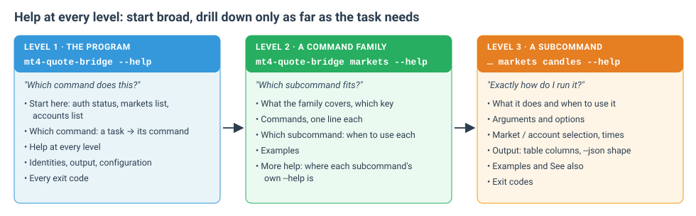

# mt4-quote-bridge manual

`mt4-quote-bridge` is the command-line client for **QuoteBridge for MetaTrader**. It talks to the QuoteBridge app's
REST API v1 on your own computer and lets you, a script or an AI agent:

- read **markets**: quotes, candles, recorded samples, history coverage, CSV/HST exports and indicator values;
- read **accounts**: Funds, a symbol's contract conditions, open positions and pending orders;
- **trade on demo accounts**: preview a new order or a change, then send that exact preview once;
- **screenshot** the app window to check that it looks healthy;
- diagnose the **terminals** and feeds behind the data.

```text
mt4-quote-bridge <command> <subcommand> [arguments] [options]
```

## Pages

| Page | Read it for |
| --- | --- |
| [Getting started](getting-started.md) | Install, create an API key in the app, sign in, first commands |
| [Concepts](concepts.md) | Exact identities, output and `--json`, numbers and times, paging, files, exit codes |
| [Markets](markets.md) | `markets`: list, show, quote, candles, samples, history, export, indicator |
| [Accounts](accounts.md) | `accounts`: list, show, funds, conditions |
| [Positions and orders](positions-and-orders.md) | `positions …` and `orders …`: reading trades and previewing changes |
| [Trading requests](trading.md) | `requests`: execute, show, review, list, and the preview → approve → execute protocol |
| [Indicators and terminals](indicators-and-terminals.md) | `indicators`: list, show; `terminals`: list, show, feeds |
| [Screenshots](screenshots.md) | `screenshot`: feeds, chart; what they do to the window, what they print, with pictures |
| [Sign-in and configuration](auth-and-config.md) | `auth`: server, login, status, logout; `config show`; environment variables |
| [Troubleshooting](troubleshooting.md) | Every exit code and error code, and what to do next |

## Help at every level

The CLI documents itself. Every command and every subcommand has `--help`, and each level answers a narrower
question:



```sh
mt4-quote-bridge --help                    # which command does what I need?
mt4-quote-bridge markets --help            # which markets subcommand fits?
mt4-quote-bridge markets candles --help    # its arguments, options, output, examples and exit codes
mt4-quote-bridge help markets              # same as "markets --help"
```

- **Level 1, the program**: *Start here*, a *Which command* table from tasks to commands, identities, output rules,
  the configuration file and every exit code.
- **Level 2, a family** (`markets`, `accounts`, `positions`, `orders`, `requests`, `indicators`, `terminals`,
  `screenshot`, `auth`, `config`): what the family covers, *Which subcommand* to use for what, examples, and a reminder
  that each subcommand has its own help.
- **Level 3, a subcommand**: what it does and when to use it, its arguments and options, how to name a market or
  account, time formats, its **Output** (table columns and the `--json` shape), **Examples**, **See also** and
  **Exit codes**.

This manual explains the same commands in more depth, with sample output and the reasoning behind the rules. When
the two ever disagree, the installed CLI's `--help` describes the version you are running.

## A five-minute tour

```sh
mt4-quote-bridge auth status                                   # signed in? which scope?
mt4-quote-bridge markets list --symbol EURUSD                  # which broker servers have EURUSD?
mt4-quote-bridge markets quote EURUSD --broker EasyForex-Demo  # the price now
mt4-quote-bridge markets candles EURUSD --broker EasyForex-Demo --timeframe H1 --limit 24
mt4-quote-bridge accounts list                                 # the account IDs
mt4-quote-bridge accounts funds --account <account-id>         # balance, equity, free margin
mt4-quote-bridge positions list --account <account-id>         # open trades
mt4-quote-bridge screenshot feeds --output feeds.png           # does the app look healthy? (trader key)
```

## Three rules worth knowing first

1. **Identities are exact.** A market is a broker server plus a symbol (`EURUSD --broker EasyForex-Demo`); an account
   is a broker server plus a login, usually passed as its ID. Nothing is matched by substring or case, and there is
   no default account. See [Concepts › Identities](concepts.md#identities).
2. **Only one command sends anything.** Every trading command previews; `requests execute <id> --confirm` sends that
   exact preview once and is never retried. See [Trading requests](trading.md).
3. **Screenshots move the user's own window.** `screenshot feeds|chart` switches the app window's view and leaves it
   there. See [Screenshots](screenshots.md).

## For agents

The agent skill [`skills/mt4-quote-bridge-cli`](../skills/mt4-quote-bridge-cli/SKILL.md) tells an
AI agent which command to reach for, when to read `--help`, and the rules for screenshots and trading it must follow.
Add it with `npx skills@latest add https://github.com/ross-jill-ws/mt4-quote-bridge-cli`; it installs the CLI itself on
first use. See [Getting started](getting-started.md#with-an-ai-agent).
