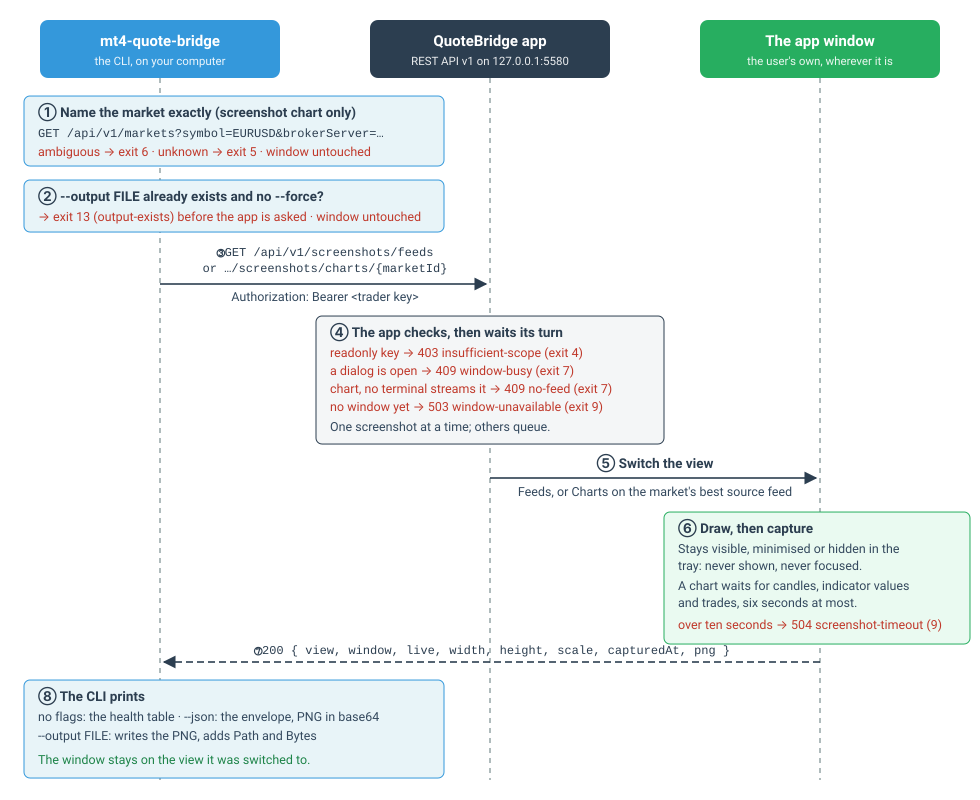
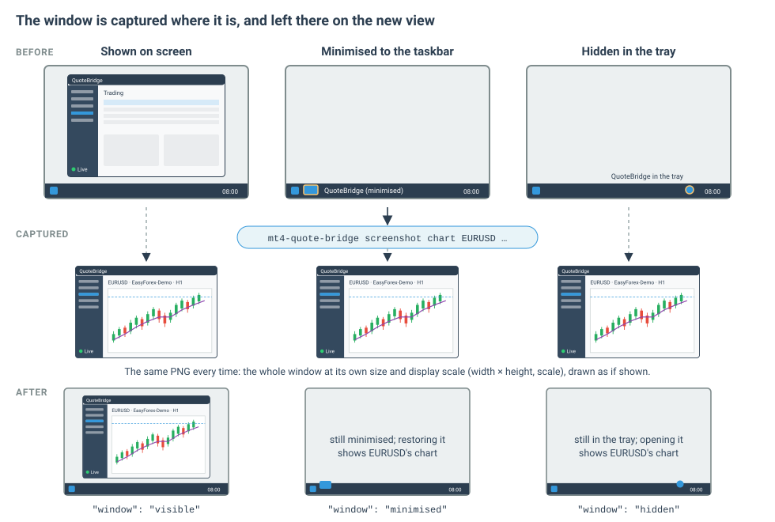
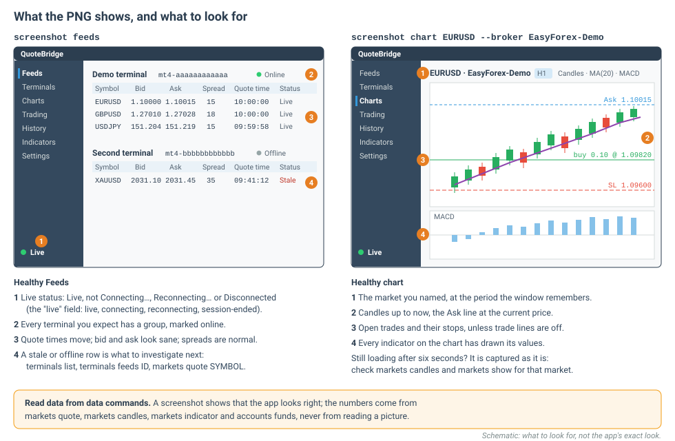
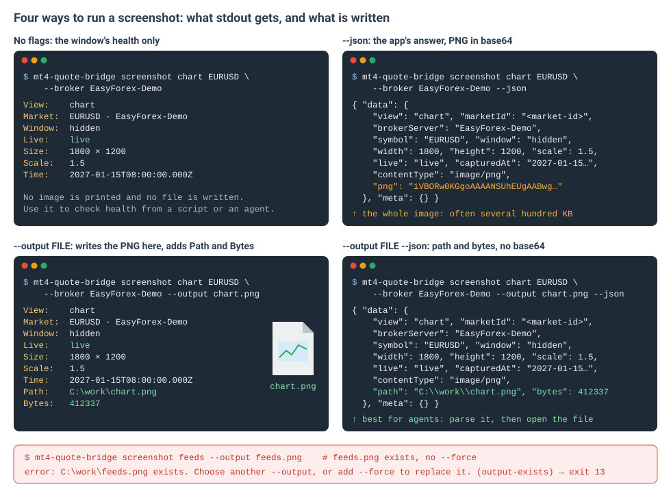

# Screenshots

[Manual](README.md) › Screenshots

`screenshot feeds` and `screenshot chart` capture **the user's own QuoteBridge app window** to check that the app
looks healthy: feeds streaming, a chart drawn, the live link up. They need a `trader` key, because they change what
the window shows.

| Command | Captures | API |
| --- | --- | --- |
| `screenshot feeds` | the window on its **Feeds** view | `GET /api/v1/screenshots/feeds` |
| `screenshot chart SYMBOL [--broker S]` or `screenshot chart --market-id ID` | the window on that market's **chart**, from its best source feed | `GET /api/v1/screenshots/charts/{marketId}` |

Both take the same options:

| Option | Meaning |
| --- | --- |
| `--output FILE` | write the PNG to `FILE` on this computer |
| `--force` | replace `FILE` if it exists (otherwise exit 13 and the window is not touched) |
| `--json` | print JSON instead of the health table |

## When to take one, and when not

| Take a screenshot | Use a data command instead |
| --- | --- |
| Someone asks to see the app, or "does QuoteBridge look OK?" | The price → `markets quote` |
| Data looks wrong and you want to see what the app shows | Bars → `markets candles` |
| After setup, to confirm feeds stream and the link is live | Indicator values → `markets indicator` |
| To check a chart draws its candles, indicators and trades | Feed health as data → `terminals list`, `terminals feeds` |

A screenshot **moves the user's window**: it is switched to Feeds or to the chart and left there. Take one on
purpose, not in a loop, and tell the user the view changed. Numbers always come from the data commands, never from
reading a picture.

## How it works



1. **The CLI names the market exactly** (`screenshot chart` only), as every market command does: an ambiguous symbol
   exits 6 and an unknown one 5, before the window is touched.
2. **The CLI checks `--output`**: if the file exists and `--force` is not given, it exits 13 before asking the app,
   so the window is not touched.
3. **The CLI asks the app** with your API key. The CLI always asks for JSON (the image in base64 beside the health
   fields).
4. **The app checks** the key's scope, that no dialog is open in the window, that the market has a feed (chart only)
   and that there is a window. One screenshot is taken at a time; others wait their turn.
5. **The window is switched** to the Feeds view, or to the Charts view on the market's best source feed: a connected
   terminal before a quiet one, then the newest broker quote, as for [`markets quote`](markets.md#markets-quote). The
   chart remembers that feed, as when the user picks it.
6. **The window draws, then is captured.** A chart is drawn as the window remembers it (its period, chart type, Ask
   line and indicators, and trade lines unless the user turned them off on that chart). The capture waits until the
   candles, every indicator's values and the trades are drawn, at most six seconds; after that it is taken with what
   the chart shows then. With no live link to the app, the chart is captured loading. The whole screenshot has ten
   seconds.
7. **The app answers** the image with the window's health.
8. **The CLI prints** the health, or the JSON, and writes the PNG when `--output` is given.

## The window stays where it is



The window is captured **whether it is shown, minimised or hidden in the tray**, without being shown or focused, and
it is left that way. The image is always the full window at its own size and display scale, drawn as if shown. What
changes is the view: the next time the user opens the window, it shows Feeds or that market's chart.

The `window` field reports how the window was: `visible`, `minimised` or `hidden`.

## What the picture shows



**Feeds** (`screenshot feeds`): the left rail with the live status at its foot, and for each terminal a group of
feeds with symbol, bid, ask, spread, quote time and status. Healthy is: status *Live*, every expected terminal online,
quote times moving.

**Chart** (`screenshot chart`): the market's chart from its best source feed, at the period the window remembers, with
the Ask line, indicators and trade lines. Healthy is: candles up to now and every indicator drawn.

## What it prints



| Flags | stdout | File |
| --- | --- | --- |
| *(none)* | the health table | — |
| `--json` | the app's answer, the PNG in base64 included | — |
| `--output FILE` | the health table plus `Path` and `Bytes` | `FILE` |
| `--output FILE --json` | the health fields plus `path` and `bytes`, without the base64 | `FILE` |

To look at the image, pass `--output`. Agents should prefer `--output FILE --json`: small JSON to parse, and a file to
open.

### The health fields

| Field | Table label | Meaning |
| --- | --- | --- |
| `view` | View | `feeds` or `chart` |
| `marketId`, `brokerServer`, `symbol` | Market | the chart's market (chart only) |
| `window` | Window | how the window was: `visible`, `minimised` or `hidden` (in the tray) |
| `live` | Live | the window's link to the app: `live` (healthy), `connecting`, `reconnecting` or `session-ended` |
| `width`, `height` | Size | the image's size in the window's own physical pixels |
| `scale` | Scale | the display's scale factor, such as `1.5` |
| `capturedAt` | Time | when the image was taken (UTC) |
| `contentType`, `png` | — | `image/png` and the image in base64 (`--json` without `--output`) |
| `path`, `bytes` | Path, Bytes | where the PNG was written and its size (`--output`) |

### The output file

`--output` follows the [file rules](concepts.md#files): a relative path is taken from the current directory and
reported as absolute; an existing file is never replaced without `--force` (exit 13, checked before the window is
touched); with `--force` the old file is replaced only once the new PNG is complete; a refused screenshot leaves no
file.

## When it is refused

| Error code | Exit | Meaning | Do next |
| --- | --- | --- | --- |
| `insufficient-scope` | 4 | a `readonly` key | ask the user for a `trader` key (`auth login`) |
| `window-busy` | 7 | a dialog is open in the window (an order, close, modify or review dialog, or the setup screen); the message names it. Nothing was switched or taken | ask the user to close it; don't retry until they have |
| `no-feed` | 7 | `screenshot chart` only: no terminal streams the market | check `markets show`, `terminals list` |
| `window-unavailable` | 9 | no window to capture: the app is starting, its window is being recreated, or the server runs without the app | wait for the app, then try once more |
| `screenshot-timeout` | 9 | not captured within ten seconds (also while the Terminals view's Remove confirmation is open). A hidden or minimised window is put back | tell the user; check the window |
| `output-exists` | 13 | `--output` exists and no `--force`; the app was not asked | choose another file or add `--force` |
| `ambiguous-market` / `unknown-market` | 6 / 5 | the market's name (chart only); the app was not asked | name it exactly |

```text
$ mt4-quote-bridge screenshot chart EURUSD --broker EasyForex-Demo
error: The order dialog is open in the app window. (window-busy)
$ echo $?
7
```

## Examples

```sh
# Is the app healthy? Health only, no image.
mt4-quote-bridge screenshot feeds

# Save the Feeds view, replacing yesterday's file.
mt4-quote-bridge screenshot feeds --output feeds.png --force

# One market's chart, as a file, with JSON to parse.
mt4-quote-bridge screenshot chart EURUSD --broker EasyForex-Demo --output eurusd.png --json

# By market ID.
mt4-quote-bridge screenshot chart --market-id <market-id> --output eurusd.png

# In a script: check the live link without saving anything.
mt4-quote-bridge screenshot feeds --json | jq -r .data.live
```
