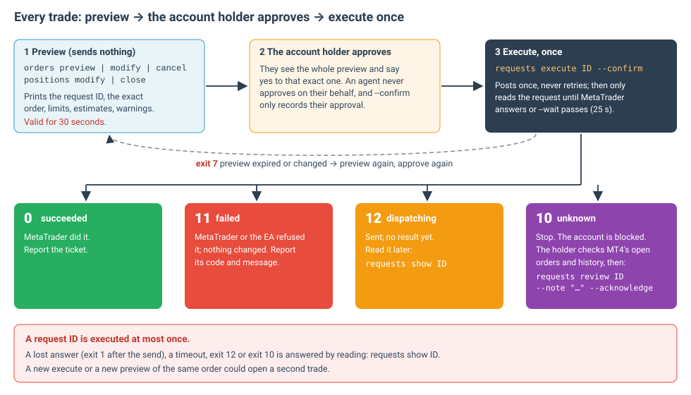

# Trading requests

[Manual](README.md) › Trading requests

Every change to an account is a **request**: first a preview, then one execute. `requests execute … --confirm` is the
only command in this CLI that sends anything to MetaTrader.



| Subcommand | Use it for | API |
| --- | --- | --- |
| [`execute ID --confirm`](#requests-execute) | send an approved preview, once | `POST /requests/{id}/execute`, then `GET /requests/{id}` |
| [`show ID`](#requests-show) | what happened to a request; a preview while it is valid | `GET /requests/{id}` |
| [`review ID --note … --acknowledge`](#requests-review) | record what was found in MetaTrader after an unknown outcome | `POST /requests/{id}/review` |
| [`list`](#requests-list) | the journal of executed requests | `GET /requests` |

## Before you trade

- **Demo accounts only.** Real accounts are readable but never trade (`executor-real-account`, exit 7).
- **A `trader` key** (a `readonly` key's preview, execute or review exits 4, `insufficient-scope`).
- **Demo trading switched on** in the app window's Settings (otherwise exit 4, `trading-disabled`).
- **Exactly one ready trading chart** for the account: `accounts list` shows `EXECUTOR ready`.
- MetaTrader's own permissions (AutoTrading, the EA's settings) are the user's to set; the app never changes them.

## The protocol

1. **Preview.** `orders preview|modify|cancel` or `positions modify|close` (see
   [Positions and orders](positions-and-orders.md)). The app checks everything against the account's terminal and
   answers the exact order execute would send. Nothing is sent. The preview is valid for 30 seconds.
2. **Approve.** The account holder reads the whole preview (account, action, price, stops, lot limits, estimates,
   warnings) and approves that exact one.
3. **Execute.** `requests execute <request-id> --confirm` within the 30 seconds. `--confirm` records the approval; it
   does not replace it, and there is no `--yes` or prompt to skip.
4. **Read the outcome** from the exit status, and if it is not final, read the request again with `requests show`.

**A request ID is executed at most once.** A repeated execute of the same ID answers the existing record and sends
nothing, but a *new* preview of the same order is a new request and could open a second trade. Lost answers,
timeouts and unknown outcomes are answered by reading, never by sending again.

## requests execute

```text
mt4-quote-bridge requests execute <request-id> --confirm [--wait SECONDS] [--json]
```

| Option | Meaning |
| --- | --- |
| `--confirm` | required: states that the account holder approved this exact preview |
| `--wait S` | how long to keep reading the request for a definitive result, 0–60 seconds (25 by default) |

Execute re-reads the account and contract and checks that the approved order still holds, records the request
durably, then sends it **once**. It then only reads the request (`GET`) every half second until MetaTrader answers or
`--wait` passes.

```text
$ mt4-quote-bridge requests execute 9f2c4e1ab7d34c0e8a6b5d4c3b2a1908 --confirm
Request:            9f2c4e1ab7d34c0e8a6b5d4c3b2a1908
Status:             succeeded
Account ID:         <account-id>
Action:             buy market 0.1 EURUSD
Price:              1.10002
…
Result:             succeeded, ticket 12345678, code 0: done
```

### Outcomes

| Exit | Status | Meaning | Do next |
| --- | --- | --- | --- |
| 0 | `succeeded` | MetaTrader did it | report the ticket |
| 11 | `failed` | MetaTrader or the EA refused it; nothing changed | report its code and message |
| 12 | `dispatching` | sent; no definitive result within `--wait` | `requests show ID` later; never execute again |
| 10 | `unknown` | no result within twenty seconds, an interrupted send, or a restart while dispatching | [stop and check MetaTrader](#unknown-outcomes) |
| 7 | — | the preview expired or no longer holds (`preview-expired`, `price-changed`, `target-changed`…) | preview again and get a fresh approval |
| 1 | — | the app could not be reached: stderr says **Nothing was sent** | fix the connection, then preview again |
| 1 | — | the answer was lost after sending: stderr says **the request may have been sent** | `requests show ID`; never execute again |

## requests show

The way to find out what happened. It only reads, so it is always safe to repeat.

```sh
mt4-quote-bridge requests show 9f2c4e1ab7d34c0e8a6b5d4c3b2a1908
mt4-quote-bridge requests show 9f2c4e1ab7d34c0e8a6b5d4c3b2a1908 --json
```

It prints the preview's fields plus `Status` and `Result`, and on stderr what to do next. Its exit status follows the
request: 0 succeeded, reviewed or a valid preview; 10 unknown and not reviewed; 11 failed; 12 still dispatching.

`--json`: `{ requestId, status, reviewed, origin, createdAt, updatedAt, accountId, marketId, terminalId,
normalizedIntent, target, limits, estimates, warnings, result: { status, ticket, code, message } | null, events: [{
type: "result" | "unknown" | "review", at, … }] }`. `events` is the append-only evidence.

## Unknown outcomes

An `unknown` outcome means QuoteBridge cannot tell whether MetaTrader acted. It **blocks the account**, previews
included (`account-unresolved`, exit 7), until a definitive result arrives or someone reviews it. Other accounts are
unaffected.

1. **Stop.** Do not execute, retry or preview that order again.
2. **Check MetaTrader**: its open orders and the account history, for a trade matching the request.
3. **Review** with what was found:

## requests review

```sh
mt4-quote-bridge requests review 9f2c4e1ab7d34c0e8a6b5d4c3b2a1908 \
  --note "Checked MT4: no such order in open trades or history" --acknowledge
```

| Option | Meaning |
| --- | --- |
| `--note TEXT` | required: what was found in MetaTrader, 8–500 characters |
| `--acknowledge` | required: states that MetaTrader's open orders and account history were checked |

Review lifts the account's block. It does not invent an outcome (the status stays `unknown`, `reviewed` becomes
`true`) and never resends; a late result can still settle the record. It works with Demo trading off. Only an unknown
request can be reviewed (`request-not-unknown`, exit 7).

## requests list

The journal of executed requests, oldest first, kept indefinitely. Previews that were never executed are not in it.

```text
$ mt4-quote-bridge requests list --account <account-id>
CREATED (UTC)             STATUS     ACTION                    TICKET    REQUEST ID
------------------------  ---------  ------------------------  --------  --------------------------------
2027-01-15T08:00:00.000Z  succeeded  place buy 0.1 EURUSD      12345678  9f2c4e1ab7d34c0e8a6b5d4c3b2a1908
2027-01-15T09:10:00.000Z  succeeded  close sell 0.1 EURUSD     12345678  0c1d2e3f4a5b6c7d8e9f0a1b2c3d4e5f
```

`--account` filters to one account; paging options as in [Concepts › Paging](concepts.md#paging).

## For scripts and agents

```sh
id=$(mt4-quote-bridge orders preview --account "$ACCOUNT" --symbol EURUSD --side buy --type market --lots 0.10 \
      --json | jq -r .data.requestId)
# … show the preview to the account holder and get their approval of this exact request …
mt4-quote-bridge requests execute "$id" --confirm --json
case $? in
  0)  echo "done" ;;
  11) echo "refused by MetaTrader" ;;
  12) echo "no result yet: run requests show $id later" ;;
  10) echo "UNKNOWN: check MetaTrader, then requests review" ;;
  7)  echo "preview expired or changed: preview again and ask again" ;;
  *)  echo "see stderr; if it says the request may have been sent, run requests show $id" ;;
esac
```

Never put a preview and its execute in one unattended step: approval belongs to the account holder, for that exact
preview.
